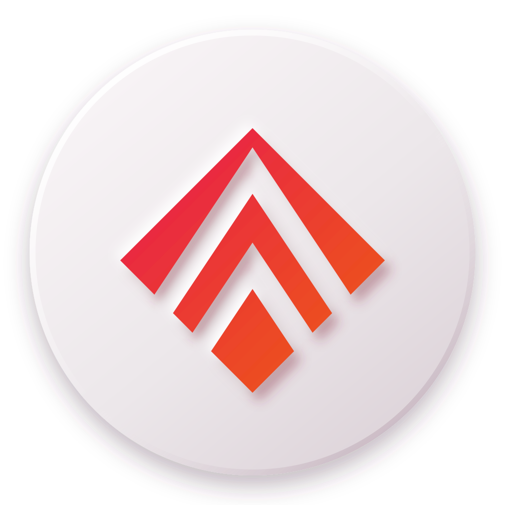

<div align="center">

  

  # ScrollSync

  **Hands-free reading: steady auto-scroll, timed clicks for galleries and comics, and gamepad control.**

  <p>
    <a href="#-features">Features</a> •
    <a href="#-install">Install</a> •
    <a href="#-controls--shortcuts">Controls</a> •
    <a href="#-development">Development</a> •
    <a href="#-project-structure">Structure</a> •
    <a href="CHANGELOG.md">Changelog</a>
  </p>

  [](https://github.com/NaveenAkalanka/ScrollSync/releases/latest)
  [](https://developer.chrome.com/docs/extensions/)
  [](https://reactjs.org/)
  [](https://vitejs.dev/)
  [](https://tailwindcss.com/)
  [](LICENSE)
  <br />
  <a href="https://www.buymeacoffee.com/naveenakalanka" target="_blank"></a>

</div>

<br />

> **Built for flow.** ScrollSync turns long reads, image galleries, comics and feeds into a smooth, low-effort experience you can drive with the mouse, the keyboard, touch or a controller.

---

## 🌟 Features

- **↕ Scroll**: steady `requestAnimationFrame` auto-scroll in px/s, up or down. Pages that only scroll sideways are handled automatically.
- **🖱 Auto Pulse**: clicks the largest visible image on a timer (left / centre / right target), for galleries, comics and slideshows.
- **🎮 Pad**: gamepad stick scrolls vertically and horizontally, buttons click, with adjustable sensitivity and stick choice.
- **🟣 Floating hub**: a draggable clay puck on the page. Click for the full panel; right-click or long-press for quick actions (power, pause, guide). Stays available while ScrollSync is off so you can turn it back on.
- **⌨ Keyboard shortcuts**: `Space`, `W`, `S`, `A`, `D`. Ctrl / Cmd / Alt combos are left to the browser.
- **💬 Hover help**: every control in the popup explains itself on hover or keyboard focus.
- **📘 Animated guide**: the guide page replays the real popup UI in a loop to show what to click for each mode.
- **🧩 Per-tab state**: each tab keeps its own settings in `chrome.storage.local`.
- **🖥 Cross-platform**: Windows, macOS, Linux and Android Chromium browsers; mouse, touch and pen; Windows High Contrast and reduced motion supported.

### Clay design (v1.1)

Version 1.1 replaces the old neon look with a soft **Clay (neumorphism)** design: one warm clay ground, paired light and shadow instead of borders, and *depth as state*: whatever is running or chosen is pressed in, everything idle is raised. The logo was redrawn to match: the same chevrons, embossed in pink-to-orange on a raised clay disc.

---

## 📦 Install

**From a release (no build needed)**

1. Download `scrollsync-<version>.zip` from the [latest release](https://github.com/NaveenAkalanka/ScrollSync/releases/latest) and unzip it.
2. Open `chrome://extensions` (or `edge://extensions`), turn on **Developer mode**.
3. Click **Load unpacked** and select the unzipped folder.

**From source**: see [Development](#-development) and load the `dist/` folder.

> Load `dist/` (or the unzipped release), not the project root. The root holds the unbuilt sources and the popup will fail with a MIME-type error.

---

## 🎛️ Controls & Shortcuts

Shortcuts work while ScrollSync is on and you're not typing in a field.

| Key | Scroll mode | Auto Pulse mode |
|---|---|---|
| `Space` | Pause / resume | Pause / resume |
| `W` / `S` | Speed up / slow down (5 px/s) | Shorter / longer interval (1 s) |
| `A` | Scroll up | Target left |
| `D` | Scroll down | Target right |

| Gamepad (Pad mode) | Action |
|---|---|
| Left or right stick | Scroll (vertical, horizontal or both) |
| A / Cross or right trigger (RT / R2) | Click |

| Floating hub | Action |
|---|---|
| Click / tap | Open the panel |
| Right-click / long-press | Quick actions |
| Drag | Move it anywhere |

---

## 🛠️ Development

```bash
git clone https://github.com/NaveenAkalanka/ScrollSync.git
cd ScrollSync
npm install
npm run dev     # popup with HMR
npm run build   # production build → dist/
```

Then open `chrome://extensions` → **Developer mode** → **Load unpacked** → select `dist/`.

**Stack:** React 18 · Vite 5 · `@crxjs/vite-plugin` (MV3) · Tailwind CSS 3 · Manrope and Material Symbols Rounded (self-hosted subset) · Chrome Extensions API · Gamepad API

The version lives only in `manifest.json`; the popup, guide and about pages read it at runtime.

---

## 🧱 Project Structure

```text
public/
  about.html       # About page
  guide.html       # User guide with animated demos
  guide-demo.js    # Looping popup replicas for the guide
  version.js       # Fills the version from the manifest
  fonts/           # Manrope + Material Symbols subset (self-hosted)
  icons/           # Toolbar / store icons 16, 32, 48, 128
  icon.svg, icon.png

src/
  background/      # Service worker (per-tab state, badge, context menus)
  content/         # Page runtime (scroll, click, gamepad, floating hub)
  App.jsx          # Popup UI
  main.jsx         # Popup entry
  index.css        # Tailwind + Clay tokens and components

brand/original/    # Backup of the original logo (not shipped)
icon.svg           # Logo source (Clay edition)
manifest.json      # Extension manifest (MV3)
vite.config.mjs    # Vite + CRX config
```

---

## 🔒 Privacy

ScrollSync collects nothing. Settings stay in your browser's local storage and nothing is sent anywhere. See [PRIVACY.md](PRIVACY.md).

---

## 📄 License

This project is licensed under the **Creative Commons Attribution-NonCommercial-ShareAlike 4.0 International (CC BY-NC-SA 4.0)** License.

You are free to:
- **Share**: copy and redistribute the material in any medium or format.
- **Adapt**: remix, transform, and build upon the material.

Under the following terms:
- **Attribution**: you must give appropriate credit, provide a link to the license, and indicate if changes were made.
- **NonCommercial**: you may not use the material for commercial purposes.
- **ShareAlike**: if you remix, transform, or build upon the material, you must distribute your contributions under the same license as the original.

See [LICENSE](LICENSE) for the full text.

<br />

<div align="center">
  <p>
    Designed & Developed with ❤️ by <a href="https://github.com/NaveenAkalanka">Naveen Akalanka</a>
    <br />
    <a href="https://www.buymeacoffee.com/naveenakalanka">Support the Project ☕</a>
  </p>
</div>
